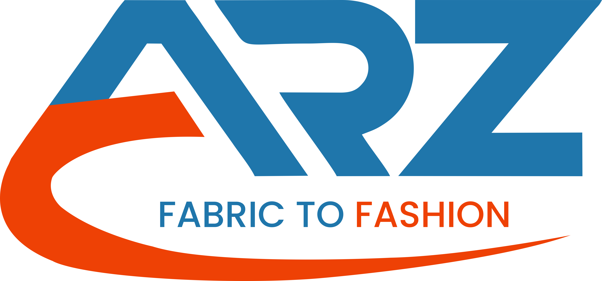
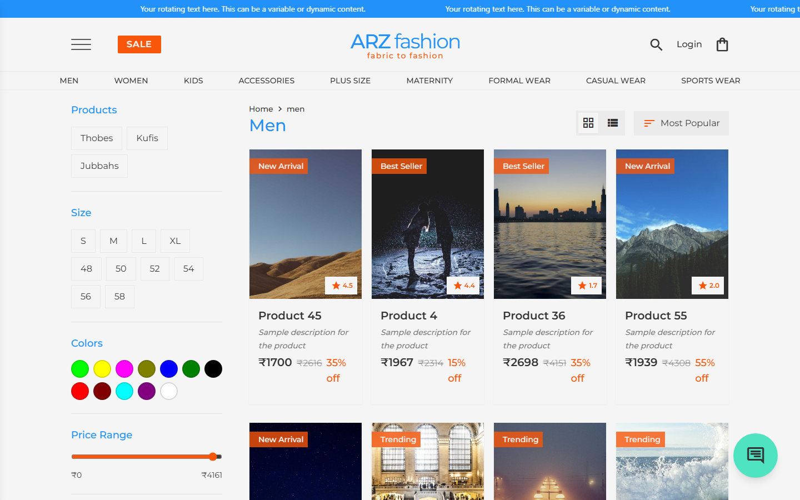
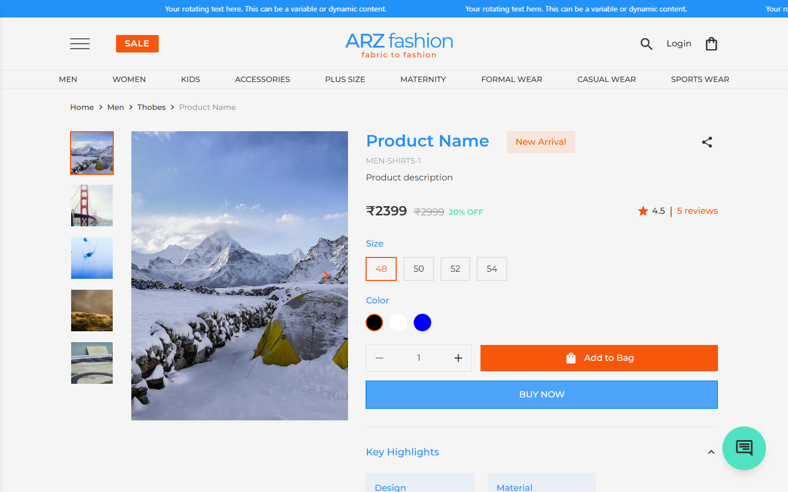
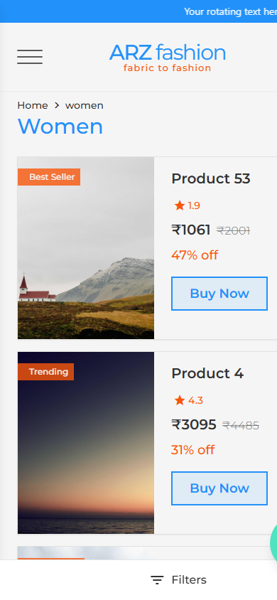
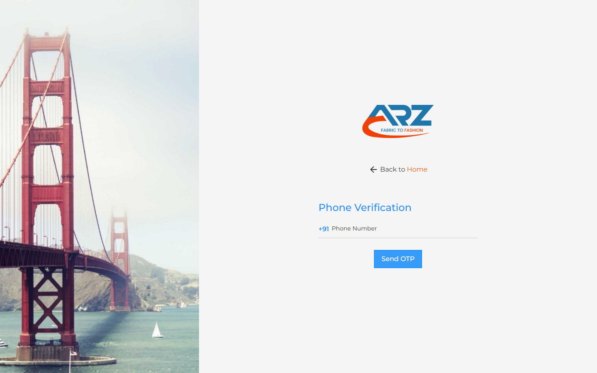
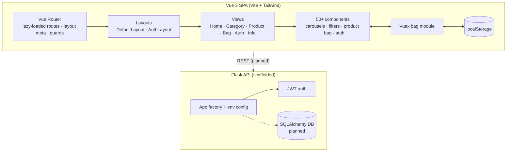

<div align="center">



# ARZ Fashion: E-commerce Storefront

### A mobile-first clothing storefront built with Vue 3 and Tailwind CSS: catalogue, filtering, product pages, bag and checkout, and OTP sign-up.

<p>
  
  
  
  
  
  
</p>

<p>
  
  
  
</p>

</div>

---

## About the project

ARZ Fashion is a storefront for an Indian clothing brand. I built it in the **first year of my degree** to learn how a real consumer product is put together, so I modelled it on the patterns of modern D2C fashion sites rather than a tutorial to-do app.

The **frontend is the heart of the project**: about 5,500 lines across 50+ Vue components, covering the full shopping journey from browsing to checkout. The **Flask backend is scaffolded** (app factory, environment-based config, JWT and CORS) but not built out, so product data is currently mocked on the client. I paused the project to focus on other work, and the README is upfront about what is and isn't finished.

<div align="center">
  
  <sub><i>Category page: multi-facet filters, sort, grid/list toggle, badges and discount pricing</i></sub>
</div>

---

## 📸 Screenshots

<table>
<tr>
<td width="68%"></td>
<td width="32%" rowspan="2"></td>
</tr>
<tr>
<td></td>
</tr>
<tr>
<td><sub><i>Product page with gallery, size/colour variants and share. Below it, step one of the OTP sign-up.</i></sub></td>
<td><sub><i>On mobile the catalogue switches to list view with a bottom filter sheet.</i></sub></td>
</tr>
</table>

> Product photos are placeholder images while the catalogue data is mocked.

---

## ✨ What's built

### 🛍️ Shopping experience
- **Catalogue with 9 top-level categories** (Men, Women, Kids, Plus Size, Maternity and more) and subcategory carousels
- **Multi-facet filtering** by subcategory, size, colour, price range (on the discounted price) and rating, combined in one computed pipeline
- **Sorting** (popularity, price high/low, newest, oldest) and a **grid / list view toggle** that switches to list view on small screens
- **Infinite scroll** using `IntersectionObserver` on the last product card, with proper teardown on unmount
- **Product page** with image gallery, size and colour variants, quantity stepper, highlights, shipping info, reviews and a **share modal** (copy link plus social share intents)

### 🧺 Bag and checkout
- **Persistent bag** in a namespaced Vuex module synced to `localStorage`, where each SKU + size + colour combination is a separate line item
- **Live order summary:** subtotal, coupon discounts (percentage and fixed), **free delivery above ₹999**, and a delivery estimate based on the slowest item
- **Payment selection** with Razorpay online payment and cash on delivery, where COD is disabled automatically if any item in the bag doesn't support it
- **OTP confirmation modal** with a resend countdown, followed by an order success screen

### 🔐 Sign-up and login
- **Three-step registration:** phone + OTP, then personal details, then address
- **Auto-advancing 6-digit OTP input** with validation
- **Searchable state and city pickers** covering every Indian state and union territory, with cities cascading from the chosen state
- Route guards that keep logged-in users out of auth pages, and **separate layouts** for auth and shopping pages

### 🧭 Navigation and brand
- Sticky header that **condenses on scroll**, with mega-menu dropdowns and **instant search** across categories and subcategories, ranked by prefix match
- Home page with banner, collection and testimonial carousels, an FAQ, a brand story, marketplace badges (Amazon, Flipkart, Myntra), and policy pages
- Floating **WhatsApp chat** button for customer support, plus a 404 page and sitemap

---

## 🏗️ Architecture



### Engineering choices worth noting

- **Code-split routes.** Every page is a dynamic `import()`, so the browser only downloads what a page needs. Route `meta` selects the layout, so auth pages render without the shop header and footer.
- **Derived state, not duplicated state.** Filtering and sorting are computed from the product list plus the active filter object, so the grid re-renders correctly whenever any facet changes and there is no hand-synced "filtered products" array.
- **Business rules live in computed properties.** The free-delivery threshold, coupon maths, COD eligibility and delivery estimate are all pure derivations, which is what made them easy to unit test.
- **Responsive by behaviour, not just by CSS.** On small screens the catalogue switches to list view and moves filters into a bottom sheet, instead of only shrinking the desktop layout.
- **Tooling from day one:** ESLint, Prettier, Vitest with Vue Test Utils, Cypress and a Vercel SPA rewrite config.

---

## 🛠️ Tech stack

| Layer | Technology |
|---|---|
| **Frontend** | Vue 3, Vue Router 4, Vuex 4, Tailwind CSS 3, vue3-carousel, Material Icons, Montserrat |
| **Tooling** | Vite 6, ESLint 9, Prettier, PostCSS, Autoprefixer |
| **Testing** | Vitest + Vue Test Utils (unit), Cypress (e2e) |
| **Backend (scaffold)** | Flask 3, Flask-JWT-Extended, Flask-CORS, python-dotenv |
| **Deployment** | Vercel (SPA rewrites) |

---

## 🧪 Tests

```bash
cd frontend
npm run test:unit
```

```
✓ src/store/__tests__/bag.spec.js                                  (5 tests)
✓ src/components/shop/bag/__tests__/CheckoutSection.spec.js        (5 tests)

Test Files  2 passed (2)
     Tests  10 passed (10)
```

The suites cover the bag store (line-item identity by SKU + size + colour, quantity updates, persistence, totals) and checkout pricing (delivery threshold, percentage and fixed coupons, invalid codes, delivery estimate).

---

## 📁 Project structure

```
.
├── frontend/
│   ├── src/
│   │   ├── views/            # Home, Category, Product, Bag, Login, Register, info pages, 404
│   │   ├── components/
│   │   │   ├── carousels/    # Banner, collections, subcategories, posters, feedback
│   │   │   ├── category/     # Filter sidebar, mobile filter sheet, sort, view toggle, product card
│   │   │   ├── product/      # Gallery, options, pricing, highlights, reviews, share, shipping
│   │   │   ├── shop/bag/     # Bag item, checkout, OTP modal, order success
│   │   │   ├── auth/         # Login, forgot password, 3-step registration
│   │   │   ├── home/         # Categories, story, FAQ, policies, marketplaces
│   │   │   └── common/       # Header, footer, WhatsApp chat
│   │   ├── layouts/          # DefaultLayout, AuthLayout
│   │   ├── router/           # Lazy routes + guards
│   │   ├── store/            # Vuex bag module
│   │   └── static/data/      # Indian states and cities
│   ├── cypress/
│   └── vercel.json
├── backend/
│   ├── app/__init__.py       # App factory
│   ├── config.py             # Env-based dev / prod config
│   └── main.py
└── docs/screenshots/
```

---

## ⚡ Run it locally

**Frontend**

```bash
cd frontend
npm install
npm run dev            # http://localhost:5173
```

**Backend (scaffold)**

```bash
cd backend
python -m venv .venv
source .venv/bin/activate        # Windows: .venv\Scripts\activate
pip install -r requirements.txt
python main.py                   # http://127.0.0.1:5000
```

---

## 🧭 Roadmap

**Done:** storefront UI, filtering and sorting, product pages, bag and checkout logic, OTP sign-up flow, responsive layouts, unit tests.

**Not yet built:**
- [ ] REST API for products, users and orders, with SQLAlchemy models
- [ ] Real OTP delivery (SMS provider) and JWT sessions wired to the frontend
- [ ] Razorpay order creation and webhook verification on the server
- [ ] Admin panel for products, inventory and orders
- [ ] Order tracking and the account page

**What I'd add if I picked it up again today:**
- **Semantic product search** with text and image embeddings, so "light linen shirt for a beach wedding" finds the right products and not just keyword matches
- **Size recommendation** from a shopper's past purchases and returns, to reduce returns
- **AI-assisted catalogue tools** that draft product descriptions and attribute tags from product photos for the admin to review

---

## 💡 What this project taught me

This was where I learned to think in **components, state and user flows** rather than pages. Building the filter pipeline, the bag store and the checkout rules showed me why derived state beats synced state, why business rules belong in pure, testable functions, and how much of the work in a product is in edge cases: COD eligibility, variant identity and mobile layouts. Those lessons carried straight into the full-stack and AI products I've built since.

---

## 👋 About me

I'm **Rafraf Reza**, a student in the IIT Madras BS programme. I build end-to-end products, and my focus today is **AI and GenAI engineering**: LLM agents, retrieval, and the infrastructure that puts them in production.

I'm open to **AI Engineer, GenAI Engineer, ML and Software Engineer** roles, remote with startups worldwide or hybrid / on-site in India.

<p>
  <a href="https://github.com/rafrafreza"></a>
</p>
